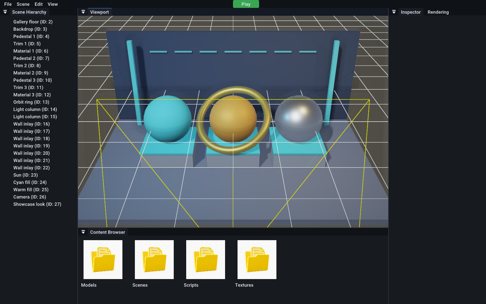
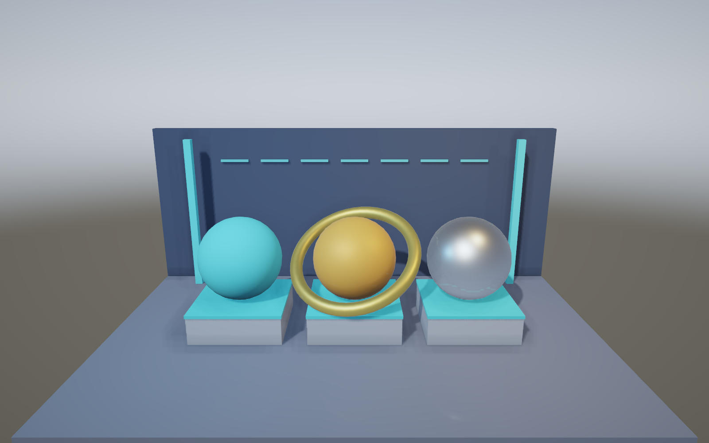

# MyEngine

A C++20 game engine with a dockable editor, native project scripts, real-time 3D rendering, physics, spatial audio and experimental OpenXR support. Windows is the current build and validation platform.



*Current engine capture. The public material gallery is included in this repository and uses only its own procedural assets.*

---

## Features

### Core
- Entity-component scene graph with parent/child relationships and UUIDs
- YAML scene serialization (`.scene` files) and project files (`.myproject`)
- Hot-reloadable native C++ scripts via DLL (`GameModule`)
- Cached shader uniforms, mesh/texture caches, conservative visibility culling and fast world transforms
- Separate editor and runtime DLL outputs
- Built-in `Engine` and `GameRuntime` build targets — the runtime is a standalone executable with no editor code

### Rendering
- Forward PBR with normal/reflectivity buffers; OpenGL 3.3 desktop / 4.5 VR (GLEW + SDL2)
- PBR materials (metallic / roughness / AO), normal mapping
- Cascaded directional shadows; point, spot and area lights
- Post-process stack: bloom, SSAO, SSR, volumetric fog, god rays, lens flare, DoF, motion blur, TAA, chromatic aberration, film grain, color grading, auto-exposure
- Mesh LODs, planar reflections, Gerstner-wave water with reflection/refraction
- Slope-aware directional shadow filtering and anisotropic texture sampling
- Particle systems, skeletal animation, 2D sprites + text rendering
- Editor grid, ImGuizmo gizmos for translate/rotate/scale

### Physics & Audio
- Bullet Physics 3 for rigid bodies, box/sphere/capsule/mesh colliders
- Built-in audio engine with 3D spatialization

### Editor
- Dockable ImGui panels: Scene Hierarchy, Inspector, Content Browser, Rendering, Viewport
- Marquee selection, multi-select transforms, undo/redo history
- Per-project recent-scene list, autosave, in-editor play mode
- Standalone game build (copies `GameRuntime.exe` + assets + `Game.dll`)

### VR (OpenXR)
- Stereoscopic per-eye rendering bound to an `XrSwapchain`
- Action-based input: grip/aim pose, trigger, squeeze, thumbstick, A/B/X/Y buttons (Touch + Index profiles)
- `VRRigComponent` for declarative rig setup in the Inspector
- `VRRigComponent` / `VRRigSystem` provide a starter rig; projects own their locomotion and interactions
- Preview Mode: simulate the HMD with mouse + WASD when no headset is attached
- Graceful fallback to flat desktop rendering if no OpenXR runtime is registered

---

## Tech Stack

| | |
|--|--|
| Language | C++20 |
| Windowing / Input | SDL2 |
| Graphics | OpenGL 3.3 desktop / 4.5 VR (GLEW) |
| Math | GLM |
| GUI | Dear ImGui (docking) + ImGuizmo |
| Physics | Bullet Physics 3 |
| Serialization | yaml-cpp |
| VR | OpenXR SDK 1.1.41 |
| Mesh loading | tinyobjloader, cgltf |
| Tests | Native C++ / CTest; optional OpenGL integration check |

All dependencies are fetched and built automatically via CMake `FetchContent`.

---

## Build

### Requirements
- Visual Studio 2022 (Desktop development with C++)
- CMake 3.20+
- Windows 10/11

### Configure & build
```bash
cmake -S . -B build
cmake --build build --config Release --target Engine GameRuntime
```

The first configure takes a few minutes — it downloads SDL2, GLM, Bullet, ImGui, ImGuizmo, GLEW, OpenXR, yaml-cpp and tinyobjloader.

After updating the engine, rebuild each project's native scripts so its
`Game.dll` matches the current engine headers and DLL:

```powershell
.\build\bin\Release\Engine.exe --build-scripts path\to\Example.myproject
```

### Run
```bash
./build/bin/Release/Engine.exe        # editor
./build/bin/Release/runtime/GameRuntime.exe path/to/Example.myproject # standalone runtime
```

---

## Editor controls

| Key | Action |
|--|--|
| Right click + WASD | Fly camera |
| Q / W / E / R | Gizmo: None / Translate / Rotate / Scale |
| Ctrl+S | Save scene |
| Ctrl+O | Open scene |
| Ctrl+Z / Ctrl+Y | Undo / Redo |
| Esc (in Play mode) | Exit play mode |

---

## Public rendering example

Open the included material gallery after building the editor:

```powershell
.\build\bin\Release\Engine.exe .\examples\RenderingShowcase\Showcase.myproject
```



The [example](examples/RenderingShowcase/README.md) includes procedural meshes,
YAML scenes and a native script. Its three materials vary in metallic/roughness
settings. Python is optional; generated assets are included. No game project or
external game assets are needed.

## VR usage

VR is opt-in. Connect a PC headset, select its OpenXR runtime, then use `--vr`:

```powershell
.\build\bin\Release\Engine.exe path\to\Example.myproject --vr
.\build\bin\Release\runtime\GameRuntime.exe path\to\Example.myproject --vr
```

The engine continues in desktop mode when OpenXR cannot initialize.
`assets/VR_Demo.scene` contains a starting rig. Its Preview Mode can simulate the
camera without a headset. This is an introductory scene; application-specific
locomotion, collision and grabbing belong in project scripts. Map tracking metres
into a game world with `VRSystem::SetTrackingOrigin`.

The API exposes predicted head, grip and aim poses; focus/tracking state; Touch
and Index actions; haptics; and controller pointing. Quality presets scale scene
resolution and select 1x/2x/4x MSAA while retaining the runtime's eye projections.

### Panels and world UI

Flat menus can use an independent 2048 x 1152 composition-layer quad. Looking
around does not move its anchor. Opening an interactive panel, or calling
`RecenterUI()`, places it in front of the current head position.

Object labels and progress bars can be submitted from
`ScriptableEntity::OnWorldUIRender()` using `GetWorldUIDrawList()`,
`SetWorldUIAnchor()` or `SetWorldUITransform()`. They have stereo parallax and
scene depth, so an opaque wall can hide them. Pixel artwork and text use the
usual ImGui draw primitives. `OnLateUpdate()` lets project scripts update tracked
visuals after simulation.

### Separate stereo look

A project can retain its desktop style while opting in to a neutral VR profile:

```cpp
auto& look = Engine::RenderSettings::Get();
look.VR.Enabled = true;
look.VR.Exposure = 1.1f;
look.VR.ContactAO = true;
```

The profile provides sRGB material decoding, controlled highlights, hemisphere
fill and contact occlusion based on actual mesh normals. The AO kernel uses a
world-oriented pattern and depth-aware blur to limit halos and screen noise.
Exposure, grading, outlines and bloom can differ from flat menus. The lowest VR
quality preset skips SSAO to reduce cost.

VR remains experimental. Simulated OpenXR and desktop OpenGL checks cannot
validate headset latency, comfort, compositor behavior or device performance.

## Checks

Native checks cover visibility culling, world UI anchoring, physical scale and
stereo parallax. No test framework download is required.

```powershell
cmake --build build --config Release --target engine_visibility engine_world_ui
ctest --test-dir build -C Release --output-on-failure
```

An optional graphics check verifies real pixels, stereo separation, wall
occlusion and index-buffer isolation between meshes. It requires a desktop
OpenGL driver:

```powershell
cmake -S . -B build -DENGINE_TEST_OPENGL=ON
cmake --build build --config Release --target engine_world_ui_gl
ctest --test-dir build -C Release --output-on-failure
```

## Separate engine and private projects

Clone the public repository separately, then copy only engine-owned paths:

```powershell
powershell -ExecutionPolicy Bypass -File tools/Export-Engine.ps1 -Destination path\to\public-clone
git -C path\to\public-clone diff --stat
```

The helper checks the destination remote and copies an explicit set of engine
directories. It skips game folders, caches, binaries and editor session files,
never transfers source Git history, and never commits or pushes. Review the
resulting diff before publishing. Keep the runtime `EngineLib.dll` with
`GameRuntime.exe` and the editor variant with `Engine.exe`.

---

## Project layout

```
src/
  Engine/        # engine library: rendering, ECS, physics, VR, editor panels
    Animation/   # skeletal animation
    Audio/       # audio engine
    Core/        # Application, Input, UUID
    Editor/      # ImGui editor panels
    Project/     # project / asset / script-build management
    Renderer/    # OpenGL backend, materials, shaders, meshes
    Scene/       # ECS scene graph, serialization
    Scripting/   # native script binding + hot-reload
    Utils/       # platform helpers
    VR/          # OpenXR session, swapchains, action system, VRRigSystem
    Window/      # SDL2 window + GL context
    Scripts/     # built-in ScriptableEntity examples
  Scripts/       # built-in generic script examples
  main.cpp       # editor + runtime entry point
assets/          # engine starter scene and fonts
resources/       # editor icons
examples/        # self-contained public material gallery
docs/            # current engine screenshots
tools/           # engine export helper
tests/           # native engine checks
```

---

## License

MIT — see `LICENSE`.
